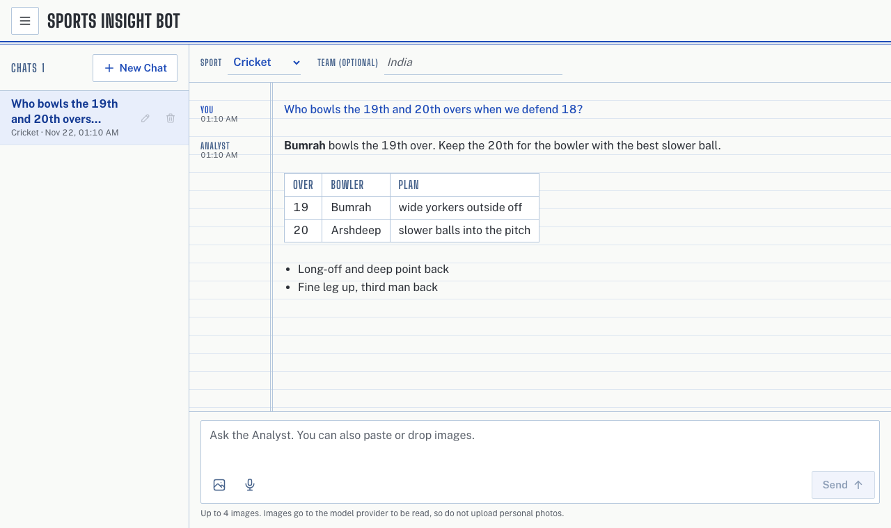
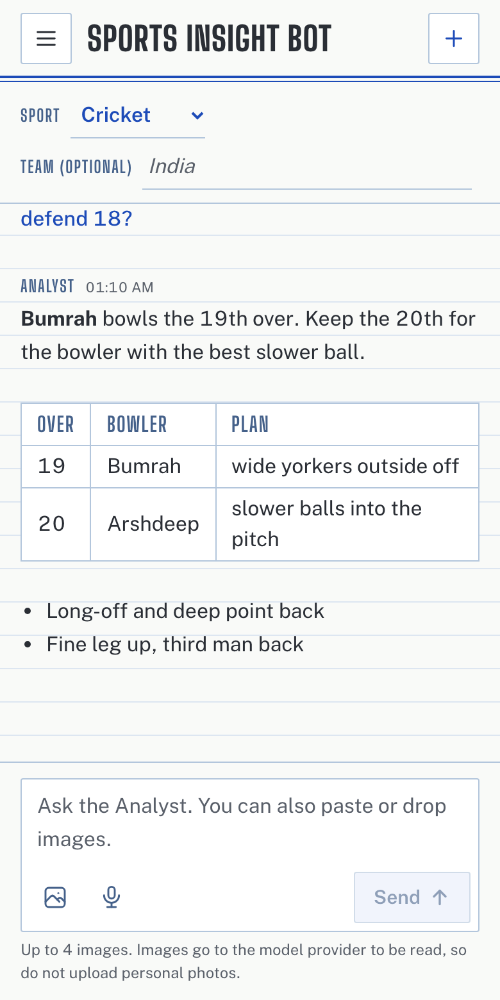
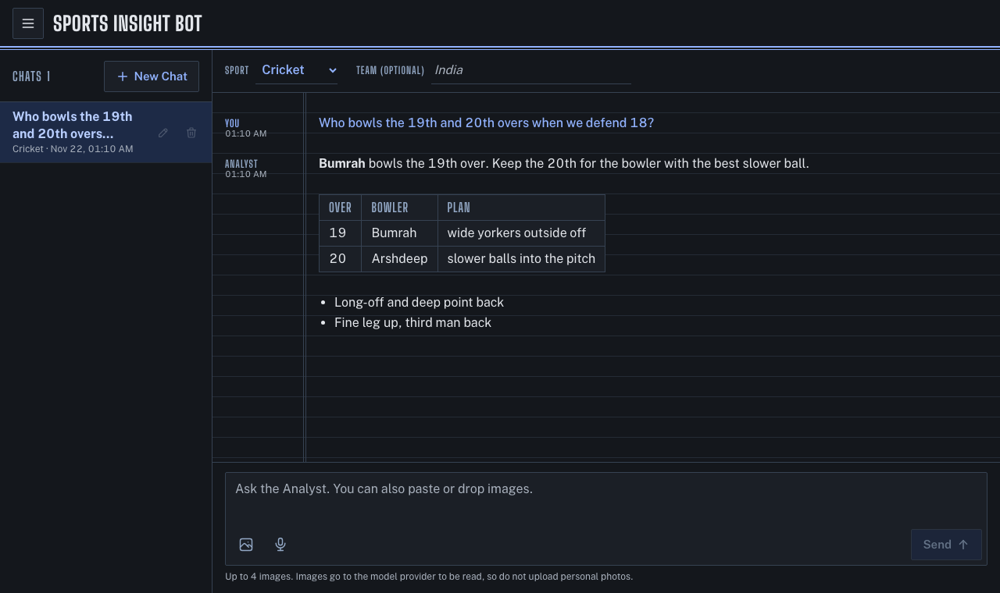
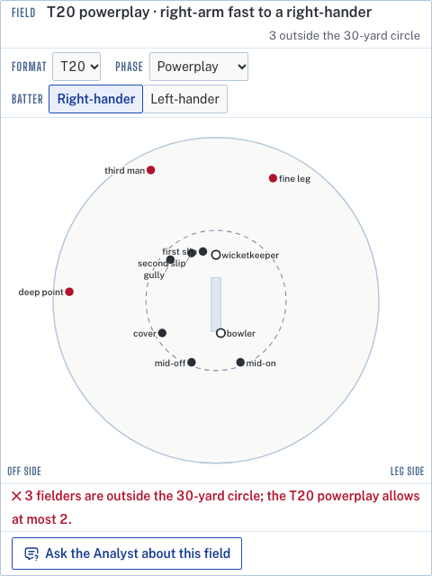
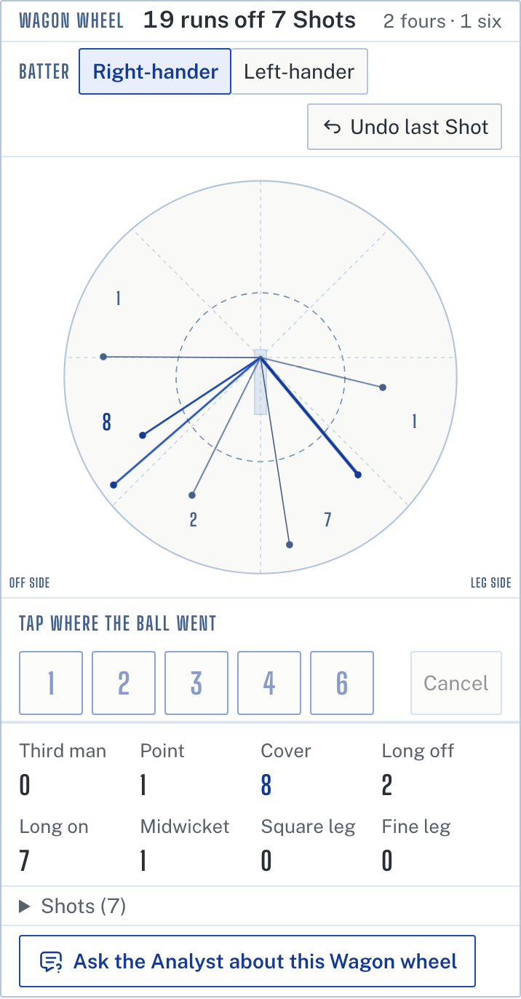

# Sports Insight Bot

A cricket-first sports Analyst you chat with. You ask about a match, a tactic or a screenshot, and the Analyst explains it. For cricket it will also draw its answer on an interactive Ground (field placements and wagon wheels).

**Status (Nov 2026): rebuild in progress.** The app is being rebuilt in 10 vertical slices. Slices 01 (walking skeleton), 02 (streaming chat), 03 (images and Sport focus), 04 (UI direction and voice input) and 05 (Field placement on the Board), 06 (interactive Board), 07 (Wagon wheel), 08 (input guard) and 09 (quality pass: explicit state machines, architecture and review) are done: you can chat with the Analyst by typing or speaking, show it up to 4 images per Message, pick the sport the Chat is about, and the reply streams in word by word as formatted text. Ask for a cricket field and the Analyst draws it on a Ground under its reply, checked against the Fielding restrictions. Then play with it: drag fielders (mouse, touch or keyboard), flip the Batter hand, change the Format and Phase, watch the live rule warnings, and ask the Analyst about your field. You can also record a batter's innings as a Wagon wheel (tap where each Shot went, pick the runs) and ask the Analyst to read it. Your Chats, with their images, are saved in your own browser.

**Live:** https://sports-insight-bot.vercel.app



| Phone | Dark mode |
|---|---|
|  |  |

### Try the Board

Open the [live app](https://sports-insight-bot.vercel.app), ask "Set a T20 powerplay field for a fast bowler", then drag a fielder out to the boundary. The Board renames the fielder to the nearest Fielding position as it moves, warns the moment the field breaks a Fielding restriction, and "Ask the Analyst about this field" gets a comment on your exact field.



### Try the Wagon wheel

Press the aperture button in the Message box ("Add a Wagon wheel"), tap where each Shot went and pick the runs. The totals by area update as you go. Then press "Ask the Analyst about this Wagon wheel" for the batter's scoring areas, strengths and weaknesses.



The old version (vanilla HTML/JS and a FastAPI server, deployed from two other repos) stopped working when its model lost all providers on OpenRouter. This repo replaces it.

## What works now

| Part | What it does |
|---|---|
| Look | "Scorer's book", chosen by the owner from four options: the Chat is a ruled scorebook page, the Analyst writes in pencil grey and the Visitor in ballpoint blue, red only for errors. Condensed athletic capitals (Big Shoulders Display) for labels and numbers, Public Sans for text. Light and dark mode follow the device. Motion (page settle, rolling numbers, a dot-ball "thinking" over, a pencil caret while streaming) turns off with the system's reduce-motion setting. Details: [docs/learning/04-ui-and-voice.md](docs/learning/04-ui-and-voice.md). |
| Layout | Desktop: the Chat list is a rail on the left, the Chat fills the rest (the Board will dock on the right). Phone (from 375 px, touch): the Chat fills the screen and the Chat list opens as a drawer from the header. No sideways scroll; every control has a label and a visible focus ring. |
| Board | Ask for a cricket field ("set a T20 powerplay field for a quick to a left-hander") and the Analyst draws its Field placement on a Ground under its reply: eleven labelled fielders, the 30-yard circle, the Pitch, the off and leg sides, and how many fielders stand outside the circle. The model can show a field only through the `show_field_placement` tool, which is offered only when the Sport focus is cricket. The server checks every field: shape (11 fielders, one bowler, one wicketkeeper, known Fielding position names, inside the Ground), the Fielding restrictions for its Format and Phase, and that each fielder stands on the side its name says. A bad field goes back to the model once with the reasons; if the repair also fails, the reply is text only. Fields are saved with the Chat and redrawn after a reload. Details: [docs/learning/05-field-placement.md](docs/learning/05-field-placement.md). |
| Interactive Board | Drag any fielder except the bowler and wicketkeeper with the mouse or a finger (the page does not scroll while you drag), or Tab to a fielder and use the arrow keys (Shift for bigger steps). While it moves, the fielder takes the name of the nearest free Fielding position. "Right-hander" / "Left-hander" mirrors every fielder. Format and Phase pickers set which Fielding restrictions apply. Live warnings under the Ground say which rule the field breaks (too many outside the 30-yard circle, too many behind square on the leg side), and those fielders turn red; the browser's check reads the same data file and passes the same test cases as the server's. Every change is saved with the Chat. "Ask the Analyst about this field" sends the field as it stands; the server checks it again and puts it, with the rules it breaks and the limits, into the prompt, so the Analyst names a broken rule first and never suggests an illegal change. Details: [docs/learning/06-interactive-board.md](docs/learning/06-interactive-board.md). |
| Wagon wheel | "Add a Wagon wheel" (cricket only) puts an empty Wagon wheel in the Chat. Tap or click where the ball went, then pick 1, 2, 3, 4 or 6; each Shot is drawn as a line from the Pitch. With the keyboard: Tab to the Ground, aim with the arrow keys, Enter, then pick the runs. "Undo last Shot" and the "Shots" list remove Shots; "Right-hander" / "Left-hander" mirrors them. Run totals for eight areas (third man, point, cover, long off, long on, midwicket, square leg, fine leg) show on the Ground and in a table. Every change is saved with the Chat. "Ask the Analyst about this Wagon wheel" sends the Shots as Board state; the server checks them (runs 1/2/3/4/6, on the Ground, at most 300), counts the totals by area itself and puts them in the prompt. Details: [docs/learning/07-wagon-wheel.md](docs/learning/07-wagon-wheel.md). |
| Voice | The mic button uses the browser's speech-to-text (Web Speech API). Words appear in the Message box while you speak, after anything you already typed; you edit and press Send. The button is hidden in browsers without speech recognition (for example Firefox). In Chrome and Edge the browser sends the audio to its own speech service; the app only gets the text. |
| Chat | Ask the Analyst a question, or start from one of the example questions in an empty Chat. A "thinking" line shows first, then the reply streams in word by word and renders as Markdown (tables, lists, bold), sanitised. **Stop** ends a reply and keeps the text so far. A failure shows a clear message with **Retry**. |
| Images | Attach, paste or drop up to 4 JPEG, PNG or WebP images per Message, with a preview and a Remove button for each. The browser shrinks each image to 1600 px on the long side (smaller if it is still over 700 KB) and keeps its real type, so a 14 MB phone photo goes out in under 1 MB. A note by the button says images go to the model provider. Images are saved with the Chat. In the prompt, text read from images is labelled as untrusted data. |
| Sport focus | Pick cricket (default), football, basketball, tennis or Other, and optionally a team. Each Chat keeps its own Sport focus and sends it with every request; it changes how the Analyst frames its answers. Non-cricket sports get text answers only. |
| Chats | Start a new Chat without a reload, see your Chats (titled from their first Message), open, rename and delete them. They live in your browser's IndexedDB, survive a reload, and no other Visitor can see them. |
| Limits | Each request sends only the last 20 Messages (the server trims again), and only the newest Message with images carries them. The server refuses a Visitor Message over 2,000 characters, more than 4 images in a Message, an image over 1 MB and an image that is not the type it claims (each a clear `error` event, before any model call), and a body over 4.5 MB (HTTP 413, like Vercel; the page shows "This Message is too large to send"). On HTTP 429 from the Vercel firewall the page says "Limit reached … try again after HH:MM". |
| Security | Two layers against prompt injection (details: [docs/learning/08-input-guard.md](docs/learning/08-input-guard.md)). **Layer 1, structure (always):** text in images is labelled as untrusted data in the prompt and in the system rules; the Analyst has only the Board tools, and the server checks every tool call before anything reaches the page. **Layer 2, the screen:** before the main model call, `openai/gpt-oss-safeguard-20b` checks the input against a written policy ([backend/app/injection_policy.md](backend/app/injection_policy.md)). To keep the cost low it runs only for Messages with images (the main model first copies out the text in them, because the screen model reads text only), Visitor Messages over 400 characters, and Messages that use words such as "instructions", "system prompt" or "you are now". A flagged request gets a `blocked` event: the page shows a polite reason and an **Edit Message** button, and takes the blocked Message out of the Chat so a follow-up does not send it again. If the screen fails (timeout, provider error, odd answer), the request fails closed with a retryable `screen_unavailable` error. |
| API | `POST /api/chat` takes `messages` (each `{role, text, images?}`, an image is `{media_type, data}` in base64) `sport_focus` (`{sport, team}`) and an optional `board` (`{field}`: the Field placement the Visitor asks about; checked like a tool call, 422 if badly shaped), and streams server-sent events: `text`, at most one `field_placement` (`{field}`: a checked Field placement), then `done` or `error` (`code`, `message`, `retryable`). A request the input guard refuses gets one `error` or one `blocked` (`{reason}`) event and nothing else. `GET /api/health` returns `{"status": "ok", "model": "<model ID>"}`. The model ID comes from `OPENROUTER_MODEL` (default `google/gemma-4-26b-a4b-it`). |
| Robustness | Each flow is one explicit state machine with its transitions written above its type: the reply (`ReplyState`), the Chat list (loading, ready, failed), image prep, voice input (`VoiceState`), the Board drag and Wagon wheel Shot entry. A quick second Enter cannot send twice, a browser that cannot save a Chat ends in a clear message instead of a stuck "thinking" line, two quick pastes still keep the 4-image limit, and words heard after Send do not come back into the Message box. State diagrams: [docs/learning/09-quality-pass.md](docs/learning/09-quality-pass.md). |
| Headers | Every response carries `X-Content-Type-Options: nosniff`, `Referrer-Policy: strict-origin-when-cross-origin`, `Permissions-Policy` (no camera or location; microphone for this site only) and a CSP that forbids framing the site (`frame-ancestors 'none'`). Set in `vercel.json`. |
| CI | Every push and pull request runs ruff, pytest, svelte-check, Vitest and Playwright. `main` only accepts pull requests with a green check. |

## Stack

| Part | Choice | Why |
|---|---|---|
| Web page | Svelte 5 + Vite + TypeScript, static build | Small compiled UI, and a framework other than the usual React default. |
| API | Python 3.12, FastAPI, managed with uv, linted with ruff, tested with pytest | Typed request and response models; uv gives one lockfile and fast installs. |
| Hosting | Vercel, one project with two Services (`frontend/`, `backend/`) | One URL, no CORS, preview deploys for feedback. See [ADR 0002](docs/adr/0002-vercel-for-both-frontend-and-api.md). |
| Model | `google/gemma-4-26b-a4b-it` on OpenRouter | Picked by a 6-model test: best text answers, only clean pass on the field JSON task, cheapest. See [docs/model-eval](docs/model-eval/README.md). |
| Model call | `httpx2` and a small SSE reader, not the `openai` SDK | One endpoint and a simple stream format; OpenRouter's error codes stay visible. `httpx2` is Pydantic's maintained fork of `httpx`. |
| Streaming | FastAPI `EventSourceResponse` → `eventsource-parser` in the page | Server-sent events over a normal POST; the parser handles split chunks and keep-alive pings. |
| Chat storage | IndexedDB through `idb` | Chats stay in the Visitor's browser, so the server keeps no state ([ADR 0001](docs/adr/0001-chats-live-only-in-the-browser.md)). |
| Markdown | `markdown-it` (`html: false`) + DOMPurify | Two layers against HTML injection: raw HTML shows as text, then the output is sanitised. |
| Image resize | Browser APIs only: `createImageBitmap` + canvas `toBlob` | No package needed. It turns photos upright from their EXIF data, keeps the image type, and drops metadata such as GPS location. |
| Look | Plain scoped CSS with CSS variables (`frontend/src/app.css`), self-hosted fonts from `@fontsource-variable` (Big Shoulders Display, Public Sans), icons from `@tabler/icons-svelte-runes` | No CSS framework to learn or override; one place for the colours of both modes; no request to Google Fonts; icons imported one by one so only the used ones are built in. |
| Voice | Web Speech API (`SpeechRecognition`), no package | Built into Chrome, Edge and Safari; free; the transcript stays editable before sending. |
| Fielding restrictions | One JSON data file (`backend/app/fielding/restrictions.json`) with the limits, the Fielding position names and a standard spot for each, plus one shared table of test cases (`backend/tests/fielding_cases.json`) | The server and the browser (`frontend/src/lib/fielding.ts`) read the same numbers and pass the same cases, so the two checks cannot disagree ([ADR 0003](docs/adr/0003-one-shared-source-for-fielding-restrictions.md)). The file lives inside `backend/` because the Vercel API function bundles only its own folder. |
| Board drawing | Plain SVG in a Svelte component, no chart or canvas library | A Ground is a few circles, a rectangle and eleven dots; SVG scales to any width and keeps text selectable and readable by screen readers. |
| Board drag | Pointer Events with pointer capture and `getScreenCTM()`, no drag library | One code path for mouse, touch and pen, and a few lines of code; arrow keys give the same moves without a pointer. |
| Injection screen | `openai/gpt-oss-safeguard-20b` on OpenRouter, with a written policy file, behind a small adapter | Built to classify text against a policy you write (the policy is the system message, the answer is `0` or `1`), so the rules are a readable file, not training data. Cheap and fast (about 1 s in the live test). A rule-based filter alone misses rephrased attacks; a second call to the main model is slower and not built for this. |
| Tests | pytest, Vitest + Testing Library, Playwright | One test layer per part: API, component, whole page in a real browser. |
| Visual feedback | Vercel Toolbar comments (preview deploys), sv-agentation (local dev only) | The owner leaves notes on the running page, and the coding agent reads and fixes them. |

## Repo layout

```
frontend/                 Svelte 5 + Vite + TypeScript page (static build)
  src/app.css                    colours (light and dark), fonts, shared button styles, reduced motion
  src/App.svelte                 header, layout, phone drawer
  src/lib/ChatView.svelte        Sport focus, the ruled Message log, thinking and streaming states, errors
  src/lib/Board.svelte           the Board: draws a Field placement (SVG); drag, keys, mirror, pickers, warnings, ask
  src/lib/Ground.svelte          the Ground under both Board drawings (boundary, circle, Pitch, sides) and screen-to-Ground maths
  src/lib/WagonWheel.svelte      the Wagon wheel on the Board: tap or keys to add Shots, runs picker, undo, remove, totals, ask
  src/lib/wagon-wheel.ts         Shots, the eight areas, totals by area, mirror
  src/lib/field-placement.ts     the Field placement type, label layout, outside-circle count
  src/lib/fielding.ts            Fielding restrictions in the browser (reads backend/.../restrictions.json), mirror, nearest position
  src/lib/Composer.svelte        Message box: images, Wagon wheel, mic, Send / Stop
  src/lib/voice-input.svelte.ts  voice input: wraps the Web Speech API
  src/lib/RollingNumber.svelte   numbers that roll to a new value
  src/lib/motion.ts              transition lengths (0 under reduced motion), the rule-drawing transition
  src/lib/SportFocusPicker.svelte  Sport and team for the open Chat
  src/lib/ChatList.svelte        Chat list: new, open, rename, delete
  src/lib/chat-session.svelte.ts page state (reply, Chat list and image prep state machines); joins the Chat store, Image prep and the stream client
  src/lib/chat-store.ts          Chats (with Sport focus) and Messages (with images, fields and Wagon wheels) in IndexedDB (idb)
  src/lib/chat-stream.ts         POST /api/chat and read the server-sent events
  src/lib/image-prep.ts          Image prep: check type and count, resize to 1600 px, base64
  src/lib/sport-focus.ts         the sports list and the default (cricket)
  src/lib/markdown.ts            Markdown to safe HTML (markdown-it + DOMPurify)
  e2e/                    Playwright tests (API mocked)
backend/                  FastAPI API, served under /api
  app/main.py             routes (GET /api/health, POST /api/chat)
  app/analyst.py          the Analyst: prompt, Sport focus, images, Board state, 20-Message history, the field tool loop (one repair), error messages
  app/wagon_wheel.py      the Wagon wheel: Shot checks, areas, totals by area for the prompt
  app/fielding/           Fielding restrictions: restrictions.json (the shared data) and the Python check + tool schema
  app/input_guard.py      the input guard, one entry guard_request(): limits (2,000 characters, 4 images, 1 MB, real types) and which Messages go to the screen
  app/injection_screen.py the injection screen adapter: reads image text, asks gpt-oss-safeguard-20b
  app/injection_policy.md the written prompt-injection policy the screen model reads
  app/openrouter.py       the OpenRouter adapter (streamed chat completions and tool calls)
  app/model_provider.py   the adapter interface the Analyst depends on
  app/events.py           the server-sent events: text, field_placement, error, blocked, done
  app/config.py           settings from environment variables
  tests/                  pytest tests (fake model provider, no network); fielding_cases.json is the shared case table
vercel.json               Vercel Services: /api/* goes to backend, all else to frontend; security headers
.github/workflows/ci.yml  CI: lint and tests on every push and pull request
docs/                     PRD, ADRs, model test, learning notes
```

## Run it locally (fresh clone)

You need [Node.js](https://nodejs.org) 24 or newer and [uv](https://docs.astral.sh/uv/) (uv installs Python 3.12 for you).

1. Clone the repo:

   ```bash
   git clone https://github.com/v1d1tt/sports-insight-bot.git
   cd sports-insight-bot
   ```

2. Start the API (terminal 1):

   ```bash
   cd backend
   cp .env.example .env
   uv sync
   uv run --env-file .env fastapi dev
   ```

   `.env` holds your OpenRouter key (`OPENROUTER_API_KEY`) and the model ID. It is git-ignored. The API runs at http://127.0.0.1:8000/api/health. If the Analyst often says it is busy, the free model variant (`:free`) is rate-limited upstream; set `OPENROUTER_MODEL=google/gemma-4-26b-a4b-it` in `.env` instead (about $0.01 per 100 chats).

3. Start the web page (terminal 2):

   ```bash
   cd frontend
   npm install
   npm run dev
   ```

   Open http://localhost:5173. Vite forwards `/api` requests to the API on port 8000, so the paths are the same as on Vercel.

## Test

API (from `backend/`):

```bash
uv run ruff check .
uv run ruff format --check .
uv run pytest
```

Web page (from `frontend/`):

```bash
npm run check                     # svelte-check and TypeScript
npm test                          # Vitest component tests
npx playwright install chromium   # once, downloads the test browser
npm run test:e2e                  # Playwright: builds the page and tests it in Chromium
```

No test calls the network or needs a key. The voice tests use a fake speech recogniser, and Playwright tests run at phone width with touch (including a real touch drag on the Board through the Chrome DevTools Protocol). pytest replaces the model with a fake provider and the injection screen with a fake screen (and tests the real OpenRouter adapter and screen adapter against scripted responses). Vitest uses an in-memory IndexedDB. Playwright mocks every `/api` request; the streaming tests use a small local SSE server, and the image tests draw their own images in the browser (no image files in the repo). CI runs all of these on every push and pull request ([workflow](.github/workflows/ci.yml)).

## Deploy

Vercel builds from GitHub. Each pull request gets a preview URL, and `main` goes to production. The Vercel project uses Root Directory `.` and Framework Preset `Services`; `vercel.json` defines the two services and turns on Fluid compute (`"fluid": true`), which gives a streamed reply up to 300 s. Environment variables on Vercel (Preview and Production):

- `OPENROUTER_API_KEY`: the OpenRouter key.
- `OPENROUTER_MODEL`: optional; without it the API uses `google/gemma-4-26b-a4b-it`.

### Setup outside the code

- **Firewall rule "Chat rate limit"** (Vercel WAF, set once per project): Request Path equals `/api/chat` AND Method equals `POST` → rate limit by IP, fixed window 10 minutes, 20 requests → HTTP 429, persistent for 1 hour. The Hobby plan allows one rate-limit rule with a window of at most 10 minutes, so the 1-hour block stands in for "20 per hour". The rule is live on this project (created 2026-11-21). To create it on a new project, use the Vercel CLI (checked with version 64.0.2; the first command stages a draft, the second makes it live):

  ```bash
  vercel firewall rules add "Chat rate limit" --condition '{"type":"path","op":"eq","value":"/api/chat"}' --condition '{"type":"method","op":"eq","value":"POST"}' --action rate_limit --rate-limit-window 600 --rate-limit-requests 20 --rate-limit-keys ip --rate-limit-algo fixed_window --rate-limit-action rate_limit --duration 1h --yes
  ```

  ```bash
  vercel firewall publish --yes
  ```

  Or in the dashboard: project → Firewall → New Rule → the same settings → Save → Review Changes → Publish. Details: [docs/learning/02-streaming-chat.md](docs/learning/02-streaming-chat.md).

## Visual feedback

- **Preview deploys:** open the preview URL from the pull request, then use the Vercel Toolbar's Comment tool. The coding agent reads these comments through the Vercel MCP.
- **Local dev:** `npm run dev` shows the sv-agentation button (bottom right; press `i` to inspect). Click an element, write a note, then copy the notes as Markdown into the chat. It loads in dev mode only and is not in production builds.

## Docs

- Plan: [PRD](docs/PRD.md) ([issue #1](https://github.com/v1d1tt/sports-insight-bot/issues/1)), built in tickets #2 to #11
- Domain terms: [GLOSSARY.md](GLOSSARY.md); decisions: [docs/adr](docs/adr)
- Model choice: [docs/model-eval](docs/model-eval/README.md)
- How each slice works: [docs/learning](docs/learning)

## Author

Vidit Arora, Software Engineering student at DTU. Interests: full-stack development, AI/ML, systems programming.
