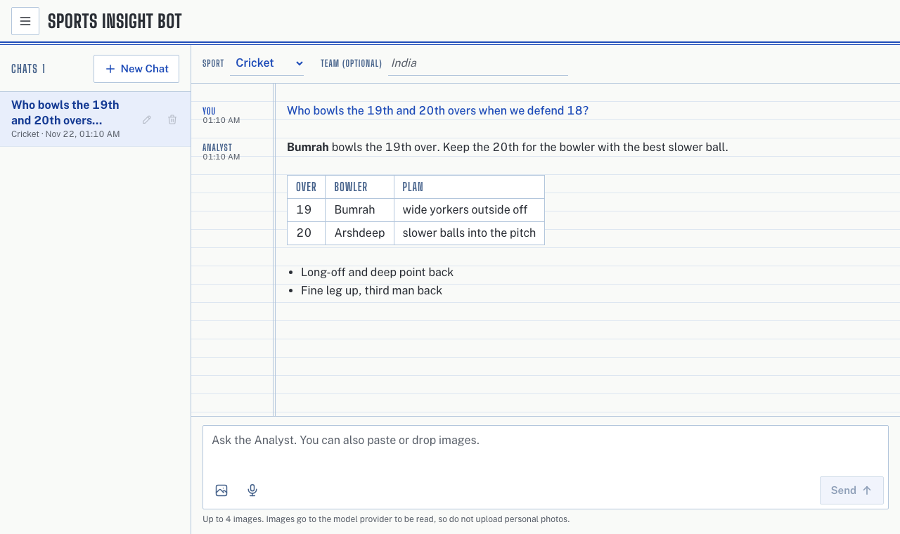
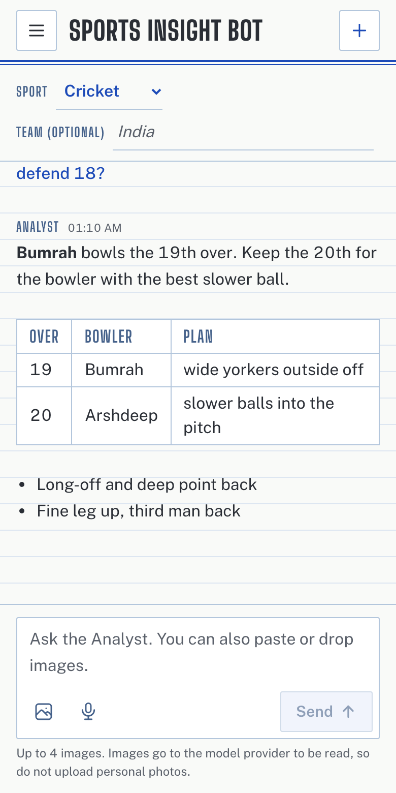
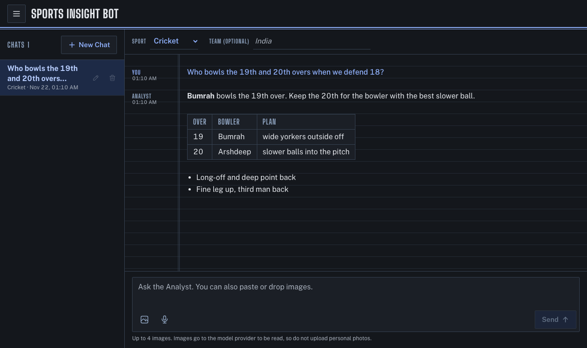

# 04: UI direction and voice input

Ticket: [#5](https://github.com/v1d1tt/sports-insight-bot/issues/5). The app gets its own look, chosen by the owner, and the Visitor can speak a question instead of typing it.

| Phone (390 px) | Desktop, dark |
|---|---|
|  |  |

## The design choices (made by the owner)

Before any UI code, the owner got one round of questions with 2-4 options each, a small mockup per option, and a recommendation. The answers:

| Question | Options shown | Chosen | Why it works for this app |
|---|---|---|---|
| Theme and colours | Match-day kit (recommended), Old scoreboard, **Scorer's book**, Floodlit night (the usual dark sports-app look) | **Scorer's book** | A cricket scorebook is the place where every ball of a match is written down and later analysed, which is exactly what the Analyst does. It is light, calm and easy to read for long answers, and nothing like the usual dark-and-neon sports app. |
| Layout | **Rail + chat + dock** (recommended), Chat with inline Boards, Ground as the stage | **Rail + chat + dock** | Most room for the answer. On desktop the Chat list is a rail on the left; from slice 06 the Board docks on the right. On a phone the Chat fills the screen and the Chat list is a drawer. |
| Fonts | **Athletic signage** (recommended), Broadcast one-family, Scoreboard tech, System only | **Big Shoulders Display + Public Sans** | Big Shoulders is condensed like stadium signs and shirt numbers, so labels and numbers feel sporty. Public Sans is a plain, very readable text face for the replies. |
| Motion | Purposeful (recommended), **Expressive**, Minimal | **Expressive** | More life: the page settles in on load, numbers roll like scoreboard plates, and the title's double rule is drawn again when the Sport changes. All of it turns off with the system's "reduce motion" setting. |

The owner's feedback round on the preview asked for two changes, both done: the Message box now runs to the right edge of the screen, the "Analyst online" line with the model name is gone from the header, the help line under the empty-Chat title is removed, and the ruled lines now run right up to the end of each line of the title (paper sits behind each line of words, not behind one box as wide as the longest line).

### What "Scorer's book" means in the code

All colours are CSS variables in `frontend/src/app.css`:

| Variable | Light | Used for |
|---|---|---|
| `--paper` | `#f9faf8` | page background |
| `--rule`, `--rule-strong` | pale print-blue | the ruled lines, boxes and column lines |
| `--pencil` | `#2a2e35` | the Analyst's writing (body text) |
| `--ink` | `#1d4bb8` | the Visitor's writing and every action (ballpoint blue) |
| `--red` | `#b3122b` | "wickets" only: errors and the mic while it records |

A `prefers-color-scheme: dark` block redefines the same variables ("the book at night"), so dark mode needs no extra rules in the components. All text pairs pass WCAG AA contrast.

- **Messages are scorebook entries, not chat bubbles.** On screens 40 rem and wider, a printed margin rule splits a name column ("YOU" / "ANALYST" and the time) from the writing. On a phone the name sits above the text.
- **The page is ruled.** The log's background is a `linear-gradient` that draws one line every `--line` (1.625 rem), which is also the body line height, so text sits on the lines. `background-attachment: local` makes the ruling scroll with the text.
- **Thinking = an over of dot balls.** While the Analyst thinks, six ball boxes fill with pencil dots one by one (CSS `@keyframes` with a delay per box).
- **Streaming = a pencil tip.** While a reply streams, a blinking 2 px bar follows the last block (`.writing > :last-child::after`).
- **Tables look like a scorecard**: printed headers in condensed capitals, whole words in cells, and a too-wide table scrolls sideways instead of widening the page.
- **Empty Chat**: a large title and three example questions; a click puts one in the Message box to edit (it does not send).

## Voice input

The mic button sits next to the image button. It uses the browser's own speech-to-text, the Web Speech API (`SpeechRecognition`).

1. `Composer.svelte` creates one `VoiceInput` (from `voice-input.svelte.ts`). If `voice.supported` is false, the mic button is not rendered at all.
2. `findSpeechRecognition()` returns `window.SpeechRecognition` or the prefixed `window.webkitSpeechRecognition` (Chrome, Edge and Safari still use the prefix; Firefox has neither, so there is no mic there).
3. A press calls `toggleVoice()`. It remembers what is already in the box, then `voice.start(onText)`.
4. `start()` makes a recogniser with `lang = navigator.language`, `interimResults = true` (words appear while the Visitor speaks) and `continuous = false` (it stops after a pause).
5. On each `result` event, `start()` joins the transcripts of all results so far and calls `onText(transcript)`. `toggleVoice()` puts "text before + transcript" in the Message box. Nothing is sent: the Visitor edits and presses Send.
6. On `end`, `listening` becomes false and the button goes back to "Start voice input". On `error`, the code becomes a plain sentence (for example `not-allowed` → "Microphone access is blocked. Allow it in your browser settings to use voice input."); `aborted` is ignored because it only means the Visitor stopped it.

While listening, the mic is red with a pulsing ring, the box border turns red, and a polite live region says "Listening… speak now." Pressing Send while listening stops the recogniser first.

**Privacy note:** in Chrome and Edge the audio goes to the browser maker's speech service to be turned into text; Safari can do it on the device. The app itself never receives audio, only the text the Visitor sends.

## How the screen is built

| File | What it does |
|---|---|
| `frontend/src/app.css` | Colour, font and motion variables, light and dark; shared `.btn` styles; focus ring, selection, caret and scrollbar colours; the global reduced-motion rule |
| `App.svelte` | Header with the title and the double rule; the grid (rail + chat); the phone drawer with its scrim and Escape key |
| `lib/ChatList.svelte` | The rail / drawer: Chat count, New Chat, one row per Chat (title, sport, date, rename and delete icons) |
| `lib/ChatView.svelte` | Sport focus picker, the ruled log, the empty-Chat opening, the thinking over, the streaming reply, error and limit notices |
| `lib/Composer.svelte` | The Message box: image previews, attach, mic, image count, Send / Stop, the image note, status and errors (split out of `ChatView`) |
| `lib/voice-input.svelte.ts` | The `VoiceInput` class around the Web Speech API |
| `lib/RollingNumber.svelte` | A number that rolls to its new value (Chat count, image count) |
| `lib/motion.ts` | `duration(ms)` (0 under reduced motion) and the `draw` transition for the double rule |

**Phone drawer.** `App.svelte` uses Svelte's `MediaQuery('max-width: 47.99rem')`. On a phone `railOpen` starts false; the header's menu button (`aria-expanded`, `aria-controls="chat-rail"`) opens the drawer. While it is open, the header and the Chat get the `inert` attribute, so keyboard focus and screen readers stay in the drawer; Escape or a tap on the scrim closes it. Opening a Chat or starting a new one closes it too (`onpick`). On desktop the same button collapses the rail.

**Motion and reduced motion.** CSS animations (page load, dots, caret, mic ring, drawer) are cut to 1 ms by one `@media (prefers-reduced-motion: reduce)` rule in `app.css`. Svelte transitions run in JavaScript, so that rule does not reach them: every transition takes its length from `duration()` in `motion.ts`, which reads Svelte's `prefersReducedMotion.current` and returns 0 when the Visitor asked for less motion.

**Icons and fonts.** Icons come from `@tabler/icons-svelte-runes`, imported one by one (`@tabler/icons-svelte-runes/icons/microphone`) so only the 12 used icons are built in. Icon-only buttons have an `aria-label`. Fonts are self-hosted from npm (`@fontsource-variable/...`), so no request goes to Google Fonts.

**Accessibility basics.** Every control has a label (the Message box keeps a hidden `<label>`), all buttons are real `<button>`s, focus shows a 2 px ink outline, touch targets are at least 36-40 px, and no screen width from 375 px up scrolls sideways.

## Removed

- `AnalystStatus.svelte` and its test: the owner asked to remove the "Analyst online" line and the model name. `GET /api/health` stays for deploy checks.
- All old styles (`GrayText` borders, system font) are gone; every screen uses the new variables.

## Versions

| Package | Version |
|---|---|
| svelte | 5.59.1 |
| @tabler/icons-svelte-runes | 3.52.0 |
| @fontsource-variable/big-shoulders-display | 5.3.0 |
| @fontsource-variable/public-sans | 5.3.0 |
| @playwright/test | 1.65.1 |

Docs checked: MDN Web Speech API (`SpeechRecognition`, `interimResults`, `SpeechRecognitionErrorEvent`) and the Tabler Icons README (through Context7), Svelte `svelte/motion` docs (`prefersReducedMotion`, through the Svelte MCP).

## Tests

- **Vitest** `voice-input.test.ts` (4 tests, with a fake recogniser): finds the standard or prefixed constructor; not supported without one; passes the full transcript, interim words included, and stops listening at the end; a blocked mic gives the clear message and a manual stop gives none.
- **Playwright** `voice-and-phone.spec.ts` (3 tests): the mic is hidden when the page has no `SpeechRecognition`; a fake recogniser fills the Message box after the text already typed and nothing is sent until Send; at 375 px with touch the page has no sideways scroll and the Chat list opens and closes as a drawer.
- All earlier Playwright flows pass unchanged in the new UI (they find controls by role and name, so a restyle does not break them). `status.spec.ts` now checks the title, the heading and an empty Chat instead of the removed status line.
- Totals: 32 Vitest, 15 Playwright, 28 pytest.

## Checked by hand

- Local dev (desktop light and dark, 375 px phone): empty Chat, drawer, error notice with Retry.
- CLI preview: one real question to the Analyst; the reply streamed with the pencil caret and a scorecard table. 1 of the 20 allowed requests used.

## Interview questions

**Why hide the mic button instead of showing a disabled one?**
A disabled button promises a feature the Visitor can never use in that browser, and on touch screens it gives no reason. Hiding it is honest. The check is a feature test (`SpeechRecognition` or `webkitSpeechRecognition` exists), not a browser-name check, so it keeps working when Firefox or another browser adds the API.

**Svelte transitions and CSS animations both move things. How do you respect "reduce motion" for both?**
CSS animations are covered by one `@media (prefers-reduced-motion: reduce)` rule that cuts their length to 1 ms. Svelte transitions are computed in JavaScript, so a media query cannot reach them; each one gets its duration from a helper that reads `prefersReducedMotion.current` (a reactive media query from `svelte/motion`) and returns 0. Without the helper, a Visitor who asked for less motion would still see every Message fly in.

**How did the restyle not break the end-to-end tests?**
The Playwright tests find elements the way a user or a screen reader does: by role and accessible name (`getByRole('button', { name: 'Send' })`, `getByRole('log', { name: 'Messages' })`). The redesign changed every class and most of the markup but kept those names, so the tests only had to change where a feature was removed on purpose (the status line). Tests tied to CSS classes would have broken everywhere.
