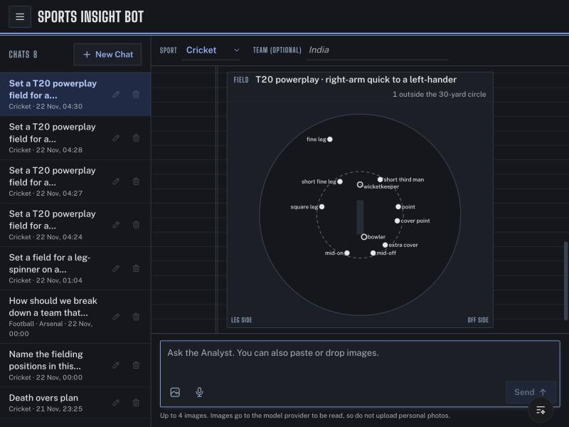

# 05: The Analyst shows a Field placement on the Board

Ticket: [#6](https://github.com/v1d1tt/sports-insight-bot/issues/6). Ask for a cricket field and the Analyst answers in text and draws the Field placement on a Ground under its reply. The server checks every field before the page sees it.



## What was built

- **A tool the model can call.** When the Sport focus is cricket, each model call offers one tool, `show_field_placement`. Its arguments are a Field placement: Format, Phase, bowler type, Batter hand and 11 fielders with `x, y` on a Ground of radius 1.
- **One shared data file** (`backend/app/fielding/restrictions.json`, [ADR 0003](../adr/0003-one-shared-source-for-fielding-restrictions.md)): the 30-yard circle, the limits per Format and Phase, the 39 Fielding position names, which names belong on the off or leg side, a standard spot for each name, and the inner position for each deep one.
- **One shared case table** (`backend/tests/fielding_cases.json`): 13 fields with the rule codes each one breaks. Python runs it now; the TypeScript check in ticket 06 must pass the same table.
- **The check** (`backend/app/fielding/__init__.py`): shape (Pydantic), Fielding restrictions, and side sense.
- **The tool loop with one repair** (`backend/app/analyst.py`).
- **The Board** (`frontend/src/lib/Board.svelte`): an SVG Ground under the Analyst's Message, saved with the Chat in IndexedDB.

## How the code flows

```
Visitor asks "set a T20 powerplay field…"
 └ ChatSession.#reply()                        frontend/src/lib/chat-session.svelte.ts
    └ streamReply(…, { onText, onFieldPlacement }) frontend/src/lib/chat-stream.ts
       └ POST /api/chat                         backend/app/main.py
          └ stream_reply(messages, provider, focus) backend/app/analyst.py
             ├ call 1: provider.stream_reply(prompt, tools=[SHOW_FIELD_PLACEMENT])
             │   OpenRouterProvider joins the streamed tool-call pieces     backend/app/openrouter.py
             │   and yields text pieces, then one ToolCall
             ├ read_field_placement(call.arguments)  backend/app/fielding/__init__.py
             │   ├ JSON → FieldPlacement (Pydantic: 11 fielders, 1 bowler, 1 keeper, known names, inside the Ground)
             │   ├ check_restrictions() → too_many_outside_circle / too_many_behind_square_leg_side
             │   └ check_sides()       → "first slip should be on the off side …"
             ├ valid   → yield FieldPlacementEvent; call 2 with tool_choice "none" → the text answer
             ├ invalid → send the problems back as the tool result; call 2 may call the tool again (the one repair)
             └ invalid again → call 3: the original prompt, no tools, "answer in text only"
       ← SSE: text … field_placement … text … done
    ← onFieldPlacement(field) → session.draftField → <Board field={…} />
 └ store.addMessage(chatId, 'analyst', text, { field })   frontend/src/lib/chat-store.ts (IndexedDB)
```

After a reload, `ChatView.svelte` draws `<Board>` for every saved Analyst Message that has a `field`.

### The tool-call protocol (OpenRouter chat completions)

1. The request carries `tools: [{type: "function", function: {name, description, parameters}}]` and `tool_choice: "auto"`.
2. The model streams its call in pieces: `choices[0].delta.tool_calls[{index, id, function: {name, arguments}}]`. The first piece has the id and name; the rest add text to `arguments`. The stream ends with `finish_reason: "tool_calls"`. `_text_pieces()` joins the pieces by `index`.
3. The server answers with two messages: the assistant message with `tool_calls`, then `{role: "tool", tool_call_id, content}`.
4. OpenRouter's docs say the follow-up request must send `tools` again. To stop a second field, the server sends `tool_choice: "none"`.

### Ground coordinates and drawing

The Ground is a circle of radius 1 at (0, 0). The striker stands at (0, 0.1) facing the bowler at (0, −0.15), so "behind square" means `y > 0.1`. For a right-hander the off side is `x < 0`; a left-hander's field is the mirror image (flip the sign of `x`). The Board draws the wicketkeeper at the top, so picture `y = −y`. `placeLabels()` puts each label on the side away from the middle and pushes a label down when it would overlap another (slip cordons are tight); a short leader line joins a moved label to its dot.

## What the real model taught this slice

The fake-model tests passed on the first day, but the real model needed three changes. Each was found with a few local runs of the Analyst against OpenRouter (not through the firewall).

1. **It wrote the tool call as text.** With a soft prompt ("call show_field_placement once"), Gemma 4 wrote `show_field_placement(format='T20', …)` or a JSON block in its reply, on several providers. A firmer rule in the system prompt ("call the tool BEFORE you write your answer … never write the field as JSON, code or a function call") made all four providers tried (Darkbloom, DeepInfra, Google Vertex, NextBit) send real tool calls.
2. **Its coordinates were on the wrong side.** For a left-hander it put the slips on the leg side and the wicketkeeper in front of the striker. That field passed the Fielding restrictions but would teach the Visitor something wrong. Two fixes: a side check (prior art: the side errors in `docs/model-eval/scripts/score.py`), and a standard spot for every position in the data file and the tool description, so the model copies and mirrors spots instead of inventing coordinates.
3. **Repairs failed for death-overs fields.** The model kept 7-9 fielders deep. The repair message now names the fielders outside the circle, says how many to move, and suggests swaps with coordinates ("deep cover -> cover (-0.33, -0.18)"). In three test runs, two repaired; the third fell back to text, as designed.

The text-only fallback first sent a `tool_choice: "none"` call after the failed attempts. Sometimes that came back empty, and the Visitor saw "empty reply". Now the fallback starts again from the original prompt, with no tools and a note "answer in text only".

## Why these choices

| Choice | Why | Alternative |
|---|---|---|
| Plain SVG in a Svelte component | A Ground is two circles, a rectangle and 11 dots. SVG scales to any width, its text is real text, and colours come from the CSS variables, so dark mode needs no extra code. | A chart library (too much for this), canvas (no text for screen readers, redraw by hand). |
| The data file inside `backend/` | The Vercel API function bundles only its own folder. A root `shared/` folder would work in local runs and could break in the deployed function. The browser (ticket 06) can import the JSON from `../backend/…` at build time. | A root `shared/` folder plus a build step that copies it. |
| The check returns sentences, not only codes | The sentences go straight back to the model as the repair reason, and the codes are what the shared case table compares. | Codes only (the model cannot act on them). |
| One repair, then text only | Each repair is another paid model call and more waiting. The ticket fixes the number at one. | Retry until valid (slow, can loop). |
| The server validates every call, even with a JSON Schema in the tool | The schema only guides the model; providers do not enforce it. This is also layer 1 of the injection defense: a tool call is data that the server checks. | Trust the schema. |

Versions: FastAPI 0.165, Pydantic 2, httpx2 2.16, Svelte 5.59, Playwright 1.65. Docs looked up in Context7: OpenRouter tool calling (chat completions format, tools sent again with tool results).

## Tests (no test calls the network)

- `backend/tests/test_fielding.py` - the shared case table (13 cases: legal fields, too many outside per Format and Phase, the leg-side limit, a mirrored left-hander, the wicketkeeper not counted, both rules broken), shape problems, side problems, and every standard spot on its own side for both hands.
- `backend/tests/test_field_placement.py` - the Chat API with the fake model: a valid call becomes a `field_placement` event between text events; after a shown field the next call has `tool_choice: "none"`; an invalid field is sent back once with its reasons; a second failure falls back to a clean text call; arguments that are not JSON are repaired too; the tool is not offered for football, basketball, tennis or Other.
- `backend/tests/test_openrouter.py` - a streamed tool call in pieces is joined; `tools` and `tool_choice` reach the request only when tools are offered.
- `frontend/src/lib/field-placement.test.ts`, `chat-stream.test.ts`, `chat-store.test.ts` - label layout, the `field_placement` event, a field saved with its Message.
- `frontend/e2e/board.spec.ts` - a mocked `field_placement` event draws 11 labelled fielders, and they are drawn again after a reload.

## Interview questions

**Q: Why not let the model put the field in its text as JSON and parse it?**
A: A tool call gives the field its own channel: the text stays readable, the server knows exactly which part is the field, and it can refuse it without touching the text. It also limits what an injected instruction can do: the model can only ask to draw a field, and the server checks that request like any other untrusted input.

**Q: The browser and the server both need the Fielding restrictions. How do you stop them from disagreeing?**
A: The limits live in one JSON file that both sides read, and one table of cases with expected results that both checks must pass in CI (ADR 0003). A rule change is one edit in the data file; if one side's code reads it wrongly, its run of the shared cases fails.

**Q: Your tests passed with the fake model, but the real one failed. What does that tell you?**
A: The fake model tests the contract: given a tool call, the server does the right thing. They cannot test whether the real model makes good calls. That needs a few real runs and changes to the prompt and the tool description, which is what happened here: three problems (tool call as text, wrong sides, failed repairs) were found only with the real model.
