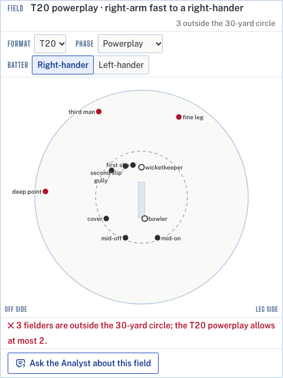

# 06: Interactive Board: drag, mirror, rules and "ask about this field"

Ticket: [#7](https://github.com/v1d1tt/sports-insight-bot/issues/7). The Visitor can now change the Analyst's Field placement on the Board and learn from it: drag fielders, flip the Batter hand, pick the Format and Phase, see live warnings, and ask the Analyst about the field as it now stands.



## What was built

- **Drag** with mouse, touch or pen (one code path: Pointer Events). While a fielder moves, it already carries the name of the nearest free Fielding position. The bowler and wicketkeeper stay where they are.
- **Keyboard**: Tab to a fielder, arrow keys move it (0.03 of the Ground's radius; Shift = 0.1). A screen reader hears "point is now deep point, outside the 30-yard circle."
- **Batter hand switch** ("Right-hander" / "Left-hander"): mirrors every fielder across the line of the Pitch (`x → -x`). The fielders glide across (220 ms); a drag never animates.
- **Format and Phase pickers**: change which Fielding restrictions apply (Phase is off for a Test).
- **Live warnings** under the Ground, in glossary words ("3 fielders are outside the 30-yard circle; the T20 powerplay allows at most 2."), and the fielders that break a rule turn red.
- **"Ask the Analyst about this field"**: sends a Visitor Message plus the Board state; the server adds the field and the rules it breaks to the prompt.
- **Saved with the Chat**: every finished change (drop, key press, picker, mirror) is written to the Analyst Message in IndexedDB. The question's Message keeps the field it asked about, so **Retry** sends the same field again.
- **The TypeScript check** (`frontend/src/lib/fielding.ts`) reads the same `restrictions.json` as the server and passes the same 13 shared cases ([ADR 0003](../adr/0003-one-shared-source-for-fielding-restrictions.md)).

## How the code flows

```
Visitor drags "point"
 └ Board.svelte onpointerdown → setPointerCapture(pointerId)
    └ onpointermove: groundPoint() = DOMPoint(clientX, clientY) × svg.getScreenCTM().inverse(), y flipped
       └ moveFielder(field, i, x, y)               frontend/src/lib/fielding.ts
          ├ clamp inside the Ground (radius 0.98)
          └ nearestPosition(x, y, hand, taken)     closest standard spot, mirrored for a left-hander
    └ derived: checkRestrictions(current)          → warnings + red dots
 └ onpointerup → onchange(field)
    └ ChatSession.editField(messageId, field)      frontend/src/lib/chat-session.svelte.ts
       └ store.setField(messageId, field)          frontend/src/lib/chat-store.ts (IndexedDB)

Visitor presses "Ask the Analyst about this field"
 └ ChatSession.askAboutField(field) → send(question, field)
    └ store.addMessage(…, 'visitor', question, { field })
    └ #reply(): last Message is a Visitor's with a field → streamReply(…, { board: { field } })
       └ POST /api/chat  { messages, sport_focus, board: { field } }   backend/app/main.py
          └ ChatRequest.board: BoardState (Pydantic: same FieldPlacement rules as the tool)
          └ stream_reply(…, board) → build_prompt(…, board)            backend/app/analyst.py
             └ _add_board(last user message): board_text() =
                "[Board state] … T20 powerplay, bowler "right-arm fast", to a right-handed batter.
                 Fielders (x, y): bowler (0.03, -0.2); …
                 It breaks these Fielding restrictions: 3 fielders are outside …"
```

## Why each choice

| Choice | Why |
|---|---|
| Pointer Events + `setPointerCapture` | One handler for mouse, touch and pen. Capture keeps the moves coming to the fielder even when the finger leaves it. |
| `getScreenCTM().inverse()` | Turns screen pixels into SVG units, whatever the Board's size or the viewBox scale. |
| A non-passive `touchmove` listener (a Svelte attachment) that calls `preventDefault()` only while dragging | Stops the page from scrolling under a finger that drags a fielder, but a swipe across the Board elsewhere still scrolls the page. `touch-action: none` on the fielders as well. |
| An invisible larger circle (`r = 0.08`) per fielder | The dot is about 7 px wide on a phone; the bigger target lets a finger pick it up. |
| Fielders keyed by index, drawn in list order, moved with `transform: translate()` | A dragged fielder's name changes while it moves; a key by name, or re-sorting the elements, would replace or move the element and lose the pointer capture. |
| Writable `$derived` (`let current = $derived(field)`) | The Board edits its own copy; a new `field` from outside (another Chat) resets it. Saving happens only on a finished change, not on every pointer move. |
| Rename to the nearest *free* position | Two fielders never share a name, so the warnings and the Analyst's comments stay clear. |
| The server re-checks the Board state and writes the broken rules into the prompt | The model does not have to count fielders itself (it is bad at it), and the browser's numbers are never trusted: the same Pydantic model as the tool rejects a bad field with HTTP 422. The bowler type is quoted with `json.dumps`, so it reads as data. |
| Vite `server.fs.allow` for `restrictions.json` | The file lives in `backend/` (the Vercel API function only bundles its own folder). The build reads it fine; the dev server needs the permission to serve it. |

## Fix after the first production check

The first real "ask" on production talked about the exact field but did not say it broke the T20 powerplay limit, and it suggested a change that also broke a rule. The rules part of the Board state now comes last (right before the model answers) and is firm: a broken field must open the reply with each broken rule and which fielders to move, the limits for the field are listed, and "Never suggest a change that breaks a Fielding restriction." Tests: `test_a_broken_field_tells_the_analyst_to_name_the_rules_first`, `test_a_legal_field_still_tells_the_analyst_the_limits`.

## Versions

Svelte 5.59.1, Vite 8.3.8, Vitest 5.1.1, Playwright 1.65.1, FastAPI 0.165.0, Pydantic 2.14.4. Docs checked in Context7: Vite `server.fs.allow`, MDN Pointer Events / `setPointerCapture` / `getScreenCTM`, Playwright mouse input.

## Tests

- `frontend/src/lib/fielding.test.ts`: the 13 shared cases, the warning wording, mirror, nearest position, move and clamp.
- `backend/tests/test_board_state.py`: Board state in the request reaches the last user message of the prompt, with every fielder and the broken rule; no Board state = the Message as typed; a bad field = 422 and no model call; the bowler type is quoted.
- `frontend/e2e/board.spec.ts`: drag a fielder outside the circle in a T20 powerplay and see the warning (and it clears in the middle overs, and survives a reload); mirror; arrow keys; "ask" sends the mirrored field; touch drag at 390 px through the Chrome DevTools Protocol, and the page does not scroll.

## Interview questions

**How does the drag work on both a laptop and a phone?**
With Pointer Events: `pointerdown` captures the pointer, `pointermove` converts the pointer's screen position to Ground units with the inverse of the SVG's screen matrix, and `pointerup` saves. The same events fire for mouse, touch and pen. On touch, a non-passive `touchmove` listener stops the page scrolling only while a fielder is held.

**How do you make sure the browser warnings and the server agree?**
Both read one data file with the limits, and both run one shared table of 13 cases in their own test suite (Vitest and pytest). If someone changes a limit or a rule on one side only, one of the two suites fails.

**Why does the server re-check a field that the browser already checked?**
The browser is not trusted: anyone can post any JSON to the API. The server validates the shape with the same Pydantic model as the Analyst's tool, and computes the broken rules itself, so the prompt says exactly what is wrong even if the page was changed.
