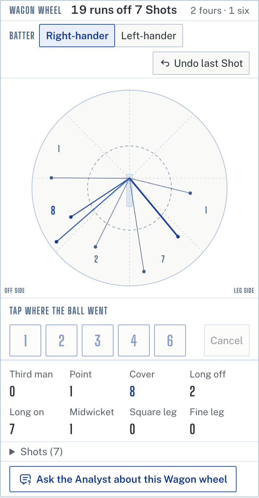

# 07: Wagon wheel

Ticket: [#8](https://github.com/v1d1tt/sports-insight-bot/issues/8). The Visitor can record a batter's innings as a Wagon wheel on the Board and ask the Analyst what it means.



## What was built

- **"Add a Wagon wheel"** (the aperture button in the Message box, shown when the Sport focus is cricket) puts an empty Wagon wheel at the end of the Chat. A new Chat is saved for it and is titled "Wagon wheel".
- **Tap to add a Shot**: tap (or click) where the ball went, then pick the runs: 1, 2, 3, 4 or 6. The Shot is drawn as a line from the striker's end of the Pitch. Fours are thicker and blue; sixes are thicker still.
- **Keyboard**: Tab to the Ground, the arrow keys move an aim ring (Shift = bigger steps), Enter picks the spot, and focus goes to the runs buttons. A screen reader hears "Aiming at cover." and "4 to cover added. 10 runs off 2 Shots."
- **Undo and remove**: "Undo last Shot" takes the last one away; the "Shots (n)" list removes any one.
- **Run totals by area**: the Ground is split into eight equal areas (third man, point, cover, long off, long on, midwicket, square leg, fine leg). The totals are written on the Ground and in a table under it; the best area is in blue.
- **Batter hand**: the switch mirrors the Shots, so each Shot keeps its area.
- **"Ask the Analyst about this Wagon wheel"** sends a question plus the Shots as Board state. The server counts the totals again and puts them in the prompt.
- **Saved with the Chat**: each finished change is written to IndexedDB, and the Wagon wheel redraws after a reload.

## How the code flows

```
Visitor presses "Add a Wagon wheel"
 └ Composer.svelte → ChatSession.startWagonWheel()           frontend/src/lib/chat-session.svelte.ts
    └ store.addMessage(chatId, 'visitor', '', { wheel: EMPTY_WAGON_WHEEL })   chat-store.ts (IndexedDB)
 └ ChatView.svelte: a Visitor Message with no text and a `wheel` → <WagonWheel>

Visitor taps the Ground, then "4"
 └ WagonWheel.svelte onclick → groundPoint(svg, event)       Ground.svelte (screen pixels → Ground units)
    └ onTheGround(x, y)? → pending = point                   wagon-wheel.ts
 └ addRuns(4) → addShot(current, { x, y, runs: 4 }) → onchange(wheel)
    └ ChatSession.editWheel(messageId, wheel) → store.setWheel(…)
 └ derived: totalsByArea(current) → areaOf(shot, hand)       wagon-wheel.ts

Visitor presses "Ask the Analyst about this Wagon wheel"
 └ ChatSession.askAboutWheel(wheel) → send(ASK_ABOUT_WHEEL, { wheel })
    └ #reply(): the Wagon wheel Message has no text, so it is left out of the history;
       the last sent Message is the question with a wheel → streamReply(…, { board: { wheel } })
       └ POST /api/chat  { messages, sport_focus, board: { wheel } }      backend/app/main.py
          └ BoardState: a field or a wheel, exactly one (Pydantic model_validator)  analyst.py
          └ board_text() → wheel_text(wheel)                             backend/app/wagon_wheel.py
             "[Board state] … 13 runs off 4 Shots (1 four, 1 six).
              Runs by area: cover 6 (2 Shots), long on 6 (1 Shot), square leg 1 (1 Shot). No runs: …
              Shots in order: 1. 4 to cover; 2. 1 to square leg; …"
```

## How an area is found

The striker stands at (0, 0.1). For a Shot at (x, y), the angle from straight (towards the bowler) is `atan2(legX, 0.1 - y)`, where `legX = x` for a right-hander and `-x` for a left-hander (the leg side is positive). Each area is 45° wide: 0-45° long on, 45-90° midwicket, 90-135° square leg, 135-180° fine leg, and the same on the off side with negative angles (long off, cover, point, third man). The same rule is written twice, in `wagon-wheel.ts` (for the drawing) and `wagon_wheel.py` (for the prompt), and both are tested against hand-worked examples.

## Why each choice

| Choice | Why |
|---|---|
| A Wagon wheel is a Visitor Message with no text | It lives in the Chat's timeline, is saved like everything else (IndexedDB, [ADR 0001](../adr/0001-chats-live-only-in-the-browser.md)) and needs no new storage. It is left out of the history sent to the model, because it is Board state, not words. |
| The question keeps its own copy of the Shots | Like the field in slice 06: **Retry** sends exactly what was asked about, even if the Visitor changes the Wagon wheel later. |
| The server counts the totals again | The browser is not trusted, and the model is bad at counting. Pydantic refuses runs other than 1, 2, 3, 4, 6, Shots off the Ground, an empty Wagon wheel, and a Board state with both a field and a wheel (HTTP 422, no model call). |
| `Ground.svelte` taken out of `Board.svelte` | Both drawings need the same boundary, 30-yard circle, Pitch and side names, and the same screen-to-Ground maths. `<svelte:options namespace="svg" />` lets a component draw inside its parent's `<svg>`. The Board looks the same as before. |
| `click` for a tap, not Pointer Events | A tap does not drag, and `click` fires for mouse, touch and pen. `touch-action: manipulation` stops a double tap from zooming the page. |
| The runs row is always shown (buttons off until a tap) | Found in the real check: when the row appeared and went away, the Ground moved under the finger between taps. |
| `role="application"` on the Ground | It is a custom widget with its own keys (arrows, Enter, Escape). The Svelte a11y warning is silenced with the reason in a comment. |
| A new Shot is drawn out from the Pitch (`stroke-dashoffset`, 420 ms) | It shows where the ball went. With reduced motion, the app's global rule cuts all animations to 1 ms. |

## Versions

Svelte 5.59.1, Vite 8.3.8, Playwright 1.65.1, FastAPI 0.165.0, Pydantic 2.14.4. Docs checked: Pydantic `model_validator(mode="after")` (Context7), Svelte `<svelte:options namespace>` (Svelte docs CLI).

## Tests

- `backend/tests/test_wagon_wheel.py` (seam 1, the Chat API with the fake model adapter): the Shots and the totals by area reach the prompt; a left-hander's areas are mirrored; five bad Board states are refused with 422 before the model is called.
- `frontend/e2e/wagon-wheel.spec.ts` (seam 3, Playwright against the mocked API): add three Shots by tap, undo one, the totals are right and survive a reload; remove a Shot from the list; add a Shot with the keyboard; "ask" sends the Shots and only the question as a Message; finger taps at 390 px with no sideways scroll.

## Interview questions

**Why do the browser and the server both work out the areas?**
The browser needs them at once, for the drawing and the table. The server cannot trust numbers from the page, and the model counts badly, so it works them out again from the Shots and writes them into the prompt. Each side is tested against the same hand-worked examples (cover, square leg, long on, a mirrored left-hander).

**How do you turn a tap into a point on the Ground?**
The SVG's screen matrix (`getScreenCTM()`) maps SVG units to screen pixels; its inverse maps the tap's `clientX/clientY` back to SVG units. The y axis is flipped because the picture has the wicketkeeper at the top.

**Why is the Wagon wheel left out of the Messages sent to the model?**
It has no words: it is Board state. Sending it as an empty Message would fail the server's check that a Visitor Message has text or images. Instead, the question about it carries the Shots in `board.wheel`, and the server adds them to the end of that question.
