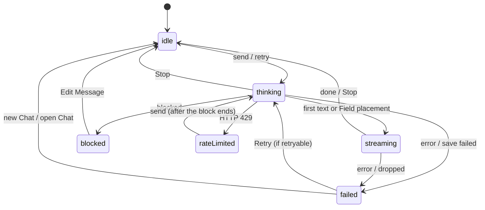
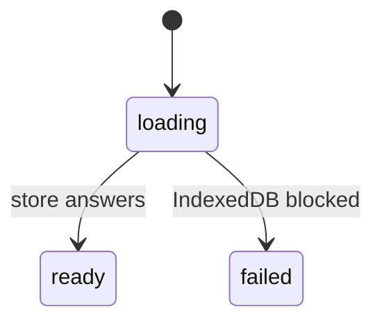
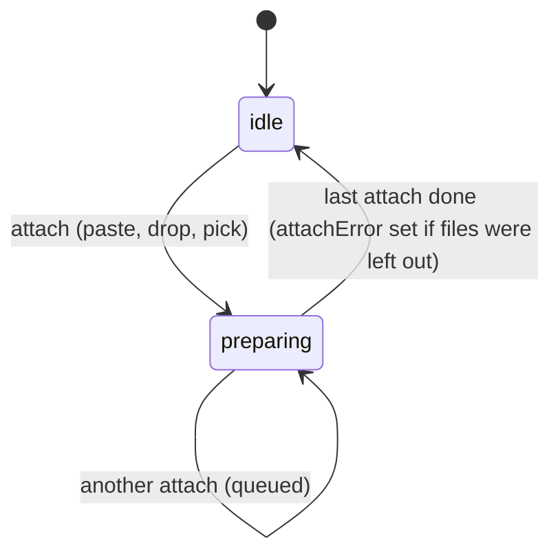
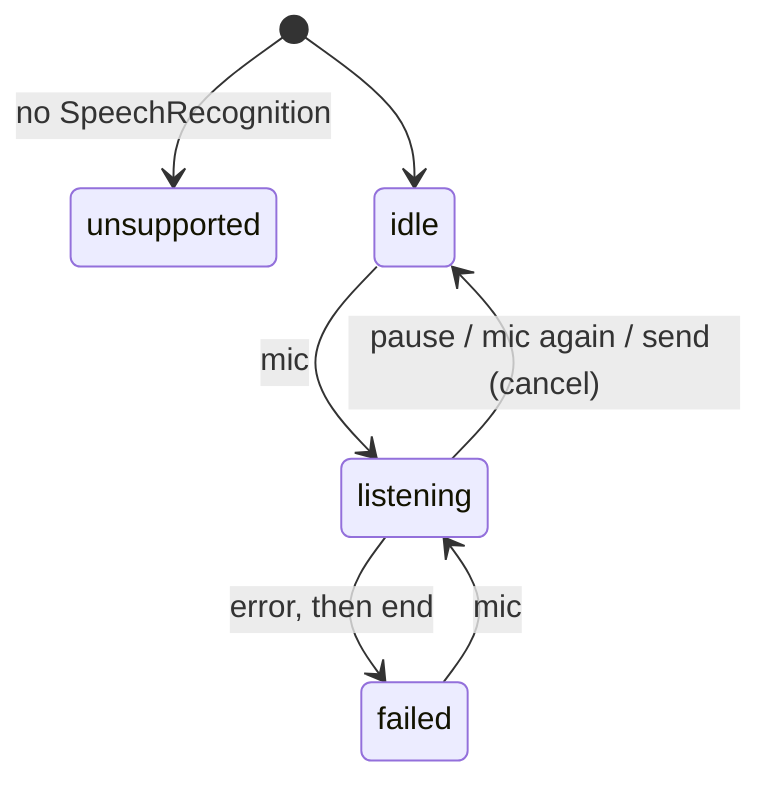

# 09: Quality pass: state machines, architecture and review

Ticket: #10. Branch: `slice/09-quality-pass`.

No new feature. Three passes over the finished app: make the implicit state machines explicit, deepen a few modules, and review the code for bugs and security. Every existing test stayed green through every change (they are the safety net). New behaviour came test-first.

**The owner was not available for this slice.** The ticket says the owner picks the architecture changes. The agent picked them instead, with the lowest risk and clearest benefit. Each choice is listed in "Choices for the owner to review" at the end, with how to undo it.

## Pass 1: state machines

The prompt, as written: "Find all of the implicit state machines in my app. Make the best decision that will elevate all three: the user experience (UX), developer experience (DX), and agent experience (AX) always, without breaking anything".

Seven machines were found. Each is now one typed value (or was already), with its transitions written in a comment above the type, so a developer or a coding agent can read the whole machine in one place.

### 1. Reply (send / stream / stop / error / retry / rate-limited / blocked)

`ReplyState` in `frontend/src/lib/chat-session.svelte.ts`. It was already a typed union. Two gaps were found and fixed:

- **Double send.** `send()` saved the Message to IndexedDB *before* it set `thinking`. During that save, `busy` was false, so a quick second Enter sent the Message twice. Now `send()` sets `thinking` first. The "Analyst is thinking…" dots also show a moment sooner.
- **Stuck spinner.** If IndexedDB failed (storage full, private mode) during a send, the error was thrown out of `send()` and the reply stayed in `thinking` for ever: Stop did nothing, Send never came back. Now a failed save ends in `failed` ("This browser could not save the Chat, so the Message was not sent.", no Retry). A failed save of the *reply* ends in `failed` too, and the streamed text stays on screen.

### 2. Chat list (loading / ready / failed)

New: `ChatListState` and `session.chatList`. Before, `chats` started as `[]`, so the list said "No Chats yet." for a moment on every load, and also when the browser blocked storage. Now the list says "Loading Chats…", then the Chats or "No Chats yet.", or "This browser does not let the page save Chats." `storeFailed` is now derived from `chatList`, so the old callers did not change.

### 3. Image prep (idle / preparing)

`session.preparing` plus `attachError`. Bug: two quick pastes (or a paste during a drop) ran two `attach()` calls at the same time. Both counted the images already attached *before* either finished, so a Message could get 6 images (the server then refused it), and the first to finish set `preparing = false` while the second was still working. Now attaches run one after the other on a promise chain (`#attaching`), and `preparing` stays true until the last one ends.

### 4. Voice input (unsupported / idle / listening / failed)

`VoiceState` in `frontend/src/lib/voice-input.svelte.ts` replaces two separate fields (`listening`, `error`). `supported`, `listening` and `error` are now getters on the one state, so `Composer.svelte` and the old tests did not change.

Bug: pressing Enter while listening called `stop()`. The Web Speech API answers `stop()` with a *final* result, which arrived after the send and filled the Message box again with the sent words. Now the send calls the new `cancel()` (`abort()` plus "ignore any later event from this recognition").

### 5. Board drag (idle / dragging)

`dragging` (a fielder index or null) in `Board.svelte`. Checked, no change: pointer capture keeps the drag on the fielder, `pointercancel` ends it like `pointerup` (the move is kept), and the page only stops scrolling while `dragging` is set.

### 6. Wagon wheel Shot entry (idle / aiming / picking runs)

`pending` (a point or null) and `aiming` in `WagonWheel.svelte`. Checked, no change: a tap or Enter sets `pending`; a run button adds the Shot; Cancel or Escape clears it; the run buttons are disabled with no point.

### 7. Chat rename (viewing / renaming)

`renamingId` in `ChatList.svelte`. Checked, no change.

## Pass 2: architecture

Vocabulary from `codebase-design`: a **deep** module gives a lot of behaviour behind a small interface; a **seam** is where that interface lives.

| # | Candidate | Applied? | Why |
|---|---|---|---|
| A | **One entry for the Input guard.** `main.py` called `check_request(...) or await screen_request(...)`, so the route had to know the order (cheap limits first, paid screen second). Now `input_guard.guard_request(messages, screen)` is the only public function; `_check_limits` and `_screen` are private. Also a small `_sse()` helper replaces two copies of the event-to-SSE line. | Yes | The PRD describes the Input guard as one module that returns accept or a reason. Low risk: the tests go through `POST /api/chat`, so none changed. |
| B | **`boardOf(message)`.** A nested ternary in `#reply()` picked the field or Wagon wheel to send. Now a small exported function with its own test. | Yes | Easier to read and test; no behaviour change. |
| C | Split `ChatSession` (≈300 lines: Chat list, open Chat, draft Message, reply) into smaller classes. | No | Biggest benefit, but the biggest diff; it touches every component. The owner should choose it. |
| D | One shared "Ground editor" for the arrow-key and announce code that `Board.svelte` and `WagonWheel.svelte` both have. | No | The two differ in detail (move vs aim); a shared module would need options for both. Small gain, UI risk. |
| E | One rule for "which Messages are sent". Both `ChatSession.#reply()` and `chat-stream.requestMessages()` drop Messages with no text and no images. | No | Harmless duplicate; removing one makes the other module's contract less clear. |

## Pass 3: review (`code-reviewer`, `secure-code-guardian`)

Fixed:

| Finding | Severity | Fix |
|---|---|---|
| Reply stuck in `thinking` when IndexedDB fails | High (stuck UI) | Pass 1, machine 1 |
| Double send on a quick second Enter | Medium | Pass 1, machine 1 |
| More than 4 images after two quick attaches | Medium | Pass 1, machine 3 |
| Sent words come back into the box after voice input | Medium | Pass 1, machine 4 |
| No security headers on the site | Medium | `vercel.json` `headers`: `X-Content-Type-Options: nosniff`, `Referrer-Policy: strict-origin-when-cross-origin`, `Permissions-Policy: camera=(), geolocation=(), microphone=(self)` (the mic stays usable), and a CSP with `frame-ancestors 'none'; object-src 'none'; base-uri 'self'` (no click-jacking in a frame). HSTS is already sent by Vercel. |

Checked and fine: Markdown is rendered with `html: false` and then DOMPurify (XSS); the API key is a `SecretStr`, only in the `Authorization` header; provider error details go to the server log, never to the page; every request field is a Pydantic model with limits; images are checked by magic bytes; `.env` is in `.gitignore` and `.vercelignore`; the firewall rate limit covers `/api/chat`.

Skipped, with reasons:

- **Strict CSP for scripts and styles** (`script-src 'self'`). The Vercel Toolbar on previews (the owner's feedback tool) loads scripts from `vercel.live`, and Svelte writes inline `style` attributes. A strict policy needs testing on both; owner's choice.
- **Store errors in `openChat`, `rename`, `remove`, `setSportFocus`** are not shown to the Visitor. Once the store has opened, these are rare; a general "could not save" notice is a follow-up.
- **The typed text is lost when the save fails on send.** The notice says the Message was not sent; putting the text back would need the Composer to keep it until the save ends.
- **The number of Messages in a request has no own limit.** The 4.5 MB body limit bounds it, and only the last 20 go to the model.
- Autofixer hint on `Composer.svelte` (`bind:this` could be an attachment): style only, not part of this change.

## Tests added

- `frontend/src/lib/chat-session.test.ts` (new; `ChatSession` with a real store on fake IndexedDB and a stubbed `fetch`): Chat list loading → ready and → failed; `thinking` at once and a second send ignored; a failed save ends in `failed`, not busy; two quick attaches keep 4 images and `preparing` stays on until the last; `boardOf`.
- `frontend/src/lib/voice-input.test.ts`: the four states; `cancel()` drops a late result.
- New seam: `ChatSession` takes an optional `resize` function, so tests skip the canvas (jsdom has none).

## How it was checked

All checks green: ruff, 104 pytest, svelte-check, 73 Vitest, 29 Playwright, build. In the in-app browser (local): a field question drew a Board; a fielder drag renamed first slip to third man and updated the count; a Wagon wheel Shot (4 to fine leg) and "Ask the Analyst about this Wagon wheel" streamed a reply; an injection showed the blocked notice; two 2400 px images were resized to 1600 px and the Analyst read the score. On the CLI preview (`vercel curl`): the four headers are sent; a field question streamed; an injection got `blocked`; an image question streamed an answer (4 POSTs).

## Versions

Svelte 5.59.1, Vitest 5.1.1, FastAPI 0.165.0, Vercel CLI 64.0.2 (`headers` in `vercel.json`, checked in Context7 `/vercel/vercel`).

## Choices for the owner to review

1. Architecture A and B applied, C–E not (table above). Undo A: put back `check_request`/`screen_request` calls in `main.py`.
2. Security headers in `vercel.json`, without a strict script CSP.
3. A failed save is `retryable: false` (Retry would reply to the previous Message, not the lost one).
4. `Board.pointercancel` keeps the move (unchanged; it could instead put the fielder back).

## Interview questions

1. **What is an implicit state machine, and why make it explicit?**
   A flow whose state is spread over several booleans (`listening`, `error`), so some mixes are impossible but nothing stops them. One typed union (`VoiceState`) has only legal states, the compiler checks every `switch`, and the transitions sit in one comment. Here it found real bugs: a reply stuck in "thinking" and a double send.

2. **How did you refactor without breaking anything?**
   The tests check behaviour through public seams (the HTTP API, the `ChatSession` class, Playwright on the page), not internals. So `check_request` could become private with no test change, and `VoiceInput` kept its old getters. New behaviour came test-first: each bug got a failing test before the fix.

3. **Why not a strict Content Security Policy?**
   It is the strongest XSS defence, but it must allow what the page really loads. The Vercel Toolbar loads scripts from another origin on previews, and Svelte uses inline styles. The XSS risk is already low (Markdown with raw HTML off, then DOMPurify), so I shipped the headers that cannot break anything and left the strict policy as a tested follow-up.
